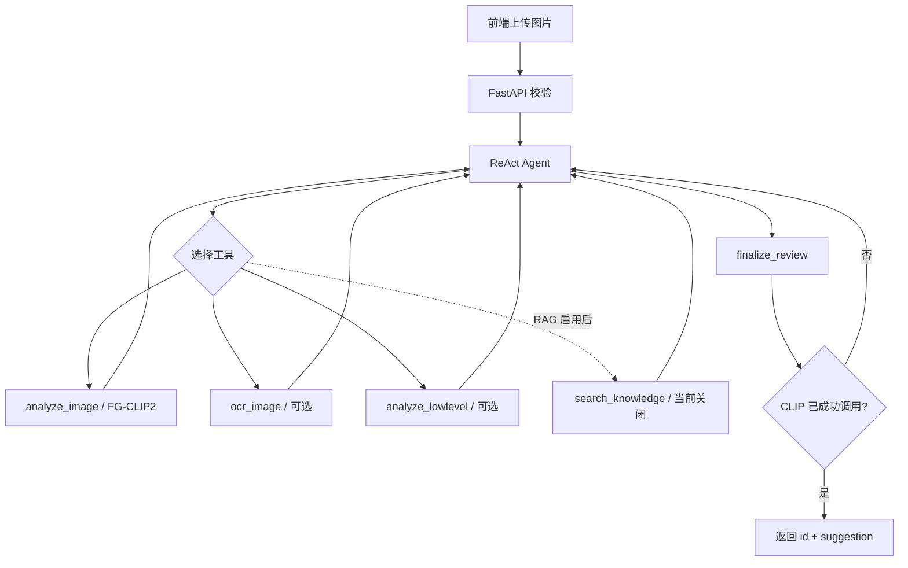

# FG-CLIP2 图片违规审核系统

本项目使用 **FG-CLIP2 视觉模型 + DeepSeek-V4-Flash ReAct Agent** 审核图片。`analyze_image` 是程序级强制调用的基础工具；GLM-OCR 和低层像素分析由 Agent 按需选择；RAG 尚未实现并已从工具列表关闭。

当前标注仍在进行。训练、推理和评估始终以现有 Label Studio 四字段格式为唯一口径，阶段性数据只用于开发和冒烟，不作为最终实验结论。

## 核心原则

- FG-CLIP2 是唯一视觉理解模块，LLM 不直接看图片。
- Agent 每次审核必须成功调用 `analyze_image`；调用守卫拒绝无 CLIP 证据的最终提交。
- `ocr_image`、`analyze_lowlevel` 是 ReAct 可选工具；OCR 固定使用智谱 GLM-OCR。
- RAG 尚未实现，当前通过 `features.rag_enabled: false` 从工具列表中硬关闭。
- API 正常响应固定为 `{id, suggestion}`，结构化证据和工具轨迹仅写后端日志。
- Mock 只用于开发联调，不能用于正式指标或冒充真实审核。
- 当前 real 模式允许原始基模配合随机分类头做通路测试，但 `trained=false` 的输出禁止作为效果或正式审核结论。

## 审核流程



同一请求中重复调用 CLIP 会返回缓存，不重复执行 GPU 推理。图片字节存放在请求级 `ContextVar`，不会进入 LLM 消息。

## 标签体系

模型使用四个输出头：

| 字段              | 类型   | 类别数 | 说明                                         |
| ----------------- | ------ | -----: | -------------------------------------------- |
| `risk_level`    | 单标签 |      5 | L0/L1/L2/L3/X                                |
| `violence_type` | 多标签 |      4 | 无暴力、直接暴力、后果展示、暗示/威胁        |
| `injury_detail` | 单标签 |      4 | 无、轻微、中度、严重                         |
| `quality`       | 单标签 |      5 | 清晰、轻微模糊、严重模糊、文字扭曲、故意遮挡 |

`target` 暂只用于数据复核，不参与本轮训练。缺失标签通过 `IGNORE_INDEX` 或 `type_valid` 掩码忽略，不会被当作负标签。

标签定义见 `src/labels.py` 和 `config/labels.yaml`。

## 目录

```text
src/
├── backend/              Agent、工具、API、OCR/RAG、Mock、日志
├── src/                  数据解析、模型、损失、推理、训练、评估
├── config/               标签、训练、推理、GLM-OCR 与 DeepSeek 独立配置
├── docs/                 架构与 API 文档
├── fg_clip/              本地 FG-CLIP2 基础模型（不提交 Git）
├── checkpoints/          LoRA adapter 与分类头
├── data/                 固定数据划分
├── eval_results/         评估指标
├── sample_images/        本地示例图片（不提交 Git）
├── tests/                自动化测试
├── run_backend.py        后端启动入口
└── requirements.txt
```

## 运行环境

项目内已经建立 `.venv`：Python 3.12 + CUDA 12.8 PyTorch，已验证可识别 RTX 5060 Ti（`sm_120`）并完成 FG-CLIP2 原始权重前向。不要使用系统的 WindowsApps `python.exe` 或父目录 CPU 环境。

安装依赖：

```powershell
.\.venv\Scripts\Activate.ps1
python -m unittest discover -s tests -v
```

## Mock 模式

如需纯 Mock 联调，把 `backend/config.yaml` 临时改为：

```yaml
runtime:
  mode: mock
```

Mock 模式无需 GPU、LLM Key、OCR 或训练权重，可用于调用守卫、API 和前端联调：

```bash
python run_backend.py
curl http://localhost:8000/health
curl -F "image=@sample_images/knife_man.jpg" http://localhost:8000/api/review
```

Mock 返回的是模拟标签，不能用于模型效果展示。

## 真实模式

修改 `backend/config.yaml`：

```yaml
runtime:
  mode: real
```

当前配置就是该模式，并用于“真实基模、未训练分类头”的全流程联调：

```yaml
model:
  device: cuda
  lora: false
  require_checkpoint: false

features:
  ocr_enabled: true
  lowlevel_enabled: true
  rag_enabled: false
```

还需配置：

- `model.path`：FG-CLIP2 基础模型目录；
- 正式模型阶段再设置 `model.ckpt_dir` 并恢复 `lora: true`、`require_checkpoint: true`；
- `config/llm.yaml` 中的 DeepSeek-V4-Flash 参数；
- `config/ocr.yaml` 中的 GLM-OCR 参数；`api_key` 可留空并由环境变量 `OCR_API_KEY` 提供。

GLM-OCR 独立配置：

```yaml
glm_ocr:
  provider: "glm_ocr"
  model: "glm-ocr"
  endpoint: "https://open.bigmodel.cn/api/paas/v4/layout_parsing"
  api_key: ""
  timeout: 20
  max_image_mb: 10
  return_crop_images: false
  need_layout_visualization: false
```

PowerShell 临时设置密钥：

```powershell
$env:OCR_API_KEY="你的智谱 API Key"
$env:LLM_API_KEY="你的 DeepSeek API Key"
python run_backend.py
```

若默认 `8000` 端口被占用，可临时设置 `$env:BACKEND_PORT="8001"`，无需修改前后端接口结构。

DeepSeek 裁决模型独立配置（可从 `config/llm.example.yaml` 复制）：

```yaml
deepseek:
  provider: "deepseek"
  model: "deepseek-v4-flash"
  base_url: "https://api.deepseek.com"
  api_key: ""
  timeout: 60
  temperature: 0.0
  max_retries: 2
```

后端只向裁决模型发送工具产生的文字证据，不发送原始图片。缺少 DeepSeek Key 时真实模式会在启动阶段给出明确错误。

`config/llm.yaml` 和 `config/ocr.yaml` 是本地敏感配置，已加入 `.gitignore`；仓库只提交对应的 `.example.yaml` 模板。若实际配置曾被 Git 跟踪，需要额外执行 `git rm --cached config/llm.yaml config/ocr.yaml` 后再提交（不会删除本地文件）。

GLM-OCR 使用 JSON + Base64 data URI 调用。后端会把 WEBP 转成 PNG，并把官方响应中的
`layout_details`/`md_results` 适配为 `{success, texts, boxes}`。OCR 只提取文字，
不向 Agent 返回图片语义描述。

正式训练完成后，真实审核应要求 checkpoint 中至少有 `head.pt`，并同时包含 LoRA adapter：

```text
checkpoints/best/
├── adapter_config.json
├── adapter_model.safetensors
├── head.pt
├── labels.json
└── metrics.json
```

## 数据体检

```bash
python -m src.dataset \
  --json project-6-at-2026-09-02-17-12-7fa70f12.json \
  --image-root /path/to/images
```

当前 JSON 是阶段性导出。确定性冲突（如“无暴力 + 其他暴力类型”）可以清理；L0 与直接暴力、L3 与无暴力等语义张力只进入复核清单，不自动修改标签。

## 训练

先在 `config/train.yaml` 填写：

```yaml
data:
  json_path: /path/to/final-label-studio.json
  image_root: /path/to/images
```

工程冒烟：

```bash
python -m src.train --config config/train.yaml --smoke-steps 1
```

正式训练：

```bash
python -m src.train --config config/train.yaml
```

最终标注冻结前的训练只用于验证代码，不作为正式结果。

## 评估

```bash
python -m src.evaluate \
  --config config/train.yaml \
  --checkpoint checkpoints/best \
  --split test
```

评估输出包括四任务基础指标、risk 混淆矩阵和 L3 recall。

## 测试

```bash
python -m unittest discover -s tests -v
```

测试覆盖标签冲突、缺失掩码、多任务损失、模型头形状、CLIP 调用守卫、API 契约、GLM-OCR、DeepSeek 配置和 RAG 硬关闭。

## Git 仓库边界

仓库只提交源码、测试、文档、依赖清单和不含密钥的配置模板。以下内容全部由 `.gitignore` 排除：

- 整个 `fg_clip/` 模型目录和所有常见权重文件；
- `checkpoints/`、`data/`、`sample_images/`、`eval_results/`；
- 根目录阶段性 Label Studio 导出 JSON；
- `config/llm.yaml`、`config/ocr.yaml`、`.env` 和密钥文件；
- `.venv/`、缓存、日志与临时文件。

克隆代码后，开发者需自行准备 `fg_clip/`，并从 `.example.yaml` 复制本地配置。模型、原始数据和标注导出通过团队约定的外部存储传递，不进入 GitHub。

## 当前边界

- 标注尚未完成，不能给出最终精度。
- OCR 已固定并适配智谱 GLM-OCR，Base64 data URI 真实调用已通过。
- 裁决 LLM 已固定为 DeepSeek-V4-Flash，真实 Agent 调用已通过。
- RAG 当前未注册给 Agent，后续实现后再打开开关。

详细设计见 `docs/architecture.md`，前后端冻结契约见 `docs/api.md`。
