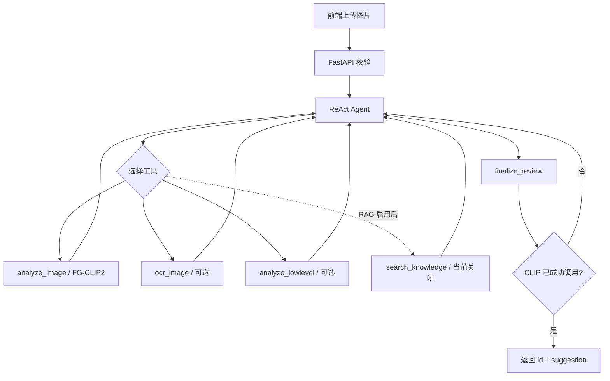

# FG-CLIP2 图片违规审核系统

本项目使用 **FG-CLIP2 视觉模型 + DeepSeek-V4-Flash ReAct Agent** 审核图片。`analyze_image` 是程序级强制调用的基础工具；GLM-OCR 和低层像素分析由 Agent 按需选择；RAG 尚未实现并已从工具列表关闭。

当前标注仍在进行。训练、推理和评估始终以现有 Label Studio 四字段格式为唯一口径，阶段性数据只用于开发和冒烟，不作为最终实验结论。

## 核心原则

- FG-CLIP2 是唯一视觉理解模块，LLM 不直接看图片。
- Agent 每次审核必须成功调用 `analyze_image`；调用守卫拒绝无 CLIP 证据的最终提交。
- `ocr_image`、`analyze_lowlevel` 是 ReAct 可选工具；OCR 固定使用智谱 GLM-OCR。
- RAG 尚未实现，当前通过 `features.rag_enabled: false` 从工具列表中硬关闭。
- API 正常响应固定为 `{id, suggestion}`，结构化证据和工具轨迹仅写后端日志。
- Mock 只用于开发联调，不能用于正式指标或冒充真实审核。
- 当前 real 模式允许原始基模配合随机分类头做通路测试，但 `trained=false` 的输出禁止作为效果或正式审核结论。

## 审核流程



同一请求中重复调用 CLIP 会返回缓存，不重复执行 GPU 推理。图片字节存放在请求级 `ContextVar`，不会进入 LLM 消息。

## 标签体系

模型使用四个输出头：

| 字段              | 类型   | 类别数 | 说明                                         |
| ----------------- | ------ | -----: | -------------------------------------------- |
| `risk_level`    | 单标签 |      5 | L0/L1/L2/L3/X                                |
| `violence_type` | 多标签 |      4 | 无暴力、直接暴力、后果展示、暗示/威胁        |
| `injury_detail` | 单标签 |      4 | 无、轻微、中度、严重                         |
| `quality`       | 多标签 |      5 | 清晰、轻微模糊、严重模糊、文字扭曲、故意遮挡 |

`quality` 使用长度为 5 的 multi-hot 向量。例如“轻微模糊 + 故意遮挡”编码为 `[0, 1, 0, 0, 1]`，标签顺序与选择先后无关。质量头仍输出 5 个 logits，训练使用带正例权重的 BCEWithLogits，推理逐类 sigmoid 后按阈值选择全部命中的标签，默认阈值为 0.5；没有类别达到阈值时返回空列表，不强制选一类。

`target` 暂只用于数据复核，不参与本轮训练。risk/injury 缺失时通过 `IGNORE_INDEX` 忽略；violence_type/quality 分别使用 `type_valid`/`quality_valid` 掩码，不会把缺失标注当作负标签。quality 包含无法映射的值时，该样本的质量任务暂不参与训练与评估，原始标注保留供复核。

质量证据统一使用 `quality.labels`（列表）、`quality.scores`（五类独立概率）和 `quality.thresholds`；CLI、Mock 和 Agent 工具均使用此格式。HTTP 正常响应仍为 `{id, suggestion}`。

标签定义见 `src/labels.py` 和 `config/labels.yaml`。

## 目录

```text
├── backend/              Agent、工具、API、OCR/RAG、Mock、日志
├── src/                  数据解析、模型、损失、推理、训练、评估
├── config/               标签、训练、推理、GLM-OCR 与 DeepSeek 独立配置
├── docs/                 架构与 API 文档
├── fg_clip/              本地 FG-CLIP2 基础模型（不提交 Git）
├── checkpoints/          LoRA adapter 与分类头
├── data/                 固定数据划分；data/clean/ 为清洗后可训练数据集（不提交 Git）
├── eval_results/         评估指标
├── sample_images/        本地示例图片（不提交 Git）
├── tests/                自动化测试
├── run_backend.py        后端启动入口
└── requirements.txt
```

## 运行环境

以下命令均从 **Git 仓库根目录**执行

Windows PowerShell 首次安装（先安装 Python 3.12 和支持 CUDA 12.8 的 NVIDIA 驱动）：

```powershell
py -3.12 -m venv .venv
.\.venv\Scripts\python.exe -m pip install --upgrade pip
.\.venv\Scripts\python.exe -m pip install torch==2.11.0 torchvision==0.26.0 --index-url https://download.pytorch.org/whl/cu128
.\.venv\Scripts\python.exe -m pip install -r requirements.txt
.\.venv\Scripts\Activate.ps1
```

若无法执行激活脚本，可将后文命令中的 `python` 替换为 `.\.venv\Scripts\python.exe`。请使用仓库内的解释器，避免误用 WindowsApps 的 Python 别名或父目录的 CPU 环境。

首次启动或运行测试前，准备本地配置；以下命令不会覆盖已有配置：

```powershell
if (-not (Test-Path config/llm.yaml)) { Copy-Item config/llm.example.yaml config/llm.yaml }
if (-not (Test-Path config/ocr.yaml)) { Copy-Item config/ocr.example.yaml config/ocr.yaml }
python -c "import torch; print(torch.__version__); print('CUDA available:', torch.cuda.is_available())"
python -B -m unittest discover -s tests -v
```

测试使用 Mock，无需真实 API Key，但配置读取测试需要上述两个 YAML 文件。real 模式还需准备完整的 `fg_clip/` 本地模型并配置密钥。环境变量覆盖 YAML 中的密钥值，不能代替配置文件本身。

## Mock 模式

如需纯 Mock 联调，把 `backend/config.yaml` 临时改为：

```yaml
runtime:
  mode: mock
```

Mock 模式无需 GPU、LLM Key、OCR 或训练权重，可用于调用守卫、API 和前端联调：

```bash
python run_backend.py
curl http://localhost:8000/health
curl -F "image=@sample_images/knife_man.jpg" http://localhost:8000/api/review
```

Mock 返回的是模拟标签，不能用于模型效果展示。

## 真实模式

修改 `backend/config.yaml`：

```yaml
runtime:
  mode: real
```

当前配置就是该模式，并用于“真实基模、未训练分类头”的全流程联调：

```yaml
model:
  device: cuda
  lora: false
  require_checkpoint: false

features:
  ocr_enabled: true
  lowlevel_enabled: true
  rag_enabled: false
```

还需配置：

- `model.path`：FG-CLIP2 基础模型目录；
- 正式模型阶段再设置 `model.ckpt_dir` 并恢复 `lora: true`、`require_checkpoint: true`；
- `config/llm.yaml` 中的 DeepSeek-V4-Flash 参数；
- `config/ocr.yaml` 中的 GLM-OCR 参数；`api_key` 可留空并由环境变量 `OCR_API_KEY` 提供。

GLM-OCR 独立配置：

```yaml
glm_ocr:
  provider: "glm_ocr"
  model: "glm-ocr"
  endpoint: "https://open.bigmodel.cn/api/paas/v4/layout_parsing"
  api_key: ""
  timeout: 20
  max_image_mb: 10
  return_crop_images: false
  need_layout_visualization: false
```

PowerShell 临时设置密钥：

```powershell
$env:OCR_API_KEY="你的智谱 API Key"
$env:LLM_API_KEY="你的 DeepSeek API Key"
python run_backend.py
```

若默认 `8000` 端口被占用，可临时设置 `$env:BACKEND_PORT="8001"`，无需修改前后端接口结构。

DeepSeek 裁决模型独立配置（可从 `config/llm.example.yaml` 复制）：

```yaml
deepseek:
  provider: "deepseek"
  model: "deepseek-v4-flash"
  base_url: "https://api.deepseek.com"
  api_key: ""
  timeout: 60
  temperature: 0.0
  max_retries: 2
```

后端只向裁决模型发送工具产生的文字证据，不发送原始图片。缺少 DeepSeek Key 时真实模式会在启动阶段给出明确错误。

`config/llm.yaml` 和 `config/ocr.yaml` 是本地敏感配置，已加入 `.gitignore`；仓库只提交对应的 `.example.yaml` 模板。若实际配置曾被 Git 跟踪，需要额外执行 `git rm --cached config/llm.yaml config/ocr.yaml` 后再提交（不会删除本地文件）。

GLM-OCR 使用 JSON + Base64 data URI 调用。后端会把 WEBP 转成 PNG，并把官方响应中的
`layout_details`/`md_results` 适配为 `{success, texts, boxes}`。OCR 只提取文字，
不向 Agent 返回图片语义描述。

正式训练完成后，真实审核应要求 checkpoint 中至少有 `head.pt`，并同时包含 LoRA adapter：

```text
checkpoints/best/
├── adapter_config.json
├── adapter_model.safetensors
├── head.pt
├── labels.json
└── metrics.json
```

新 checkpoint 的 `labels.json` 包含 `schema_version: 2`、各任务类型和类别顺序，quality 的任务类型为 `multi_label`。旧单标签 quality 权重虽然也是 5 维，其训练含义不同，加载时会拒绝；请按多标签链路重新训练。存在权重但缺少标签契约的 checkpoint 也会被拒绝。

## 前后端联调

后端把 `frontend_1008/frontend` 挂载到 `/`，直接访问 http://localhost:8000/ 即可。前端只使用相对地址 `/health` 和 `/api/review`，所以必须与 API 同源访问（不要用 `file://` 打开 `index.html`，那会进入离线预览模式）。

先用 Mock 验证接口契约（不需要任何 Key）：

```powershell
wsl -d Ubuntu
conda activate fgclip
cd /mnt/d/Image-Review-Agent
BACKEND_MODE=mock python run_backend.py
```

Windows 浏览器打开 http://localhost:8000/。`/health` 应返回 `{"status":"ok","service_ready":true,"model_loaded":true,"mock":true}`。

真实模式（使用 2026-10-18 训练权重）需要 DeepSeek Key：

```bash
export LLM_API_KEY="你的 DeepSeek API Key"     # 或写进 config/llm.yaml
python run_backend.py                           # backend/config.yaml 默认 mode=real
```

- `backend/config.yaml` 已设为 `lora: true`、`require_checkpoint: true`、`ckpt_dir: checkpoints/best`，缺少权重会拒绝启动。
- `features.ocr_enabled` 默认 `false`。拿到智谱 GLM-OCR Key 后填入 `config/ocr.yaml`，再把该开关改为 `true`。
- `config/llm.yaml`、`config/ocr.yaml` 是本地敏感配置（已被 `.gitignore` 排除），不要提交。
- 端口被占用时用 `BACKEND_PORT=8001 python run_backend.py`。

## 数据体检

```bash
python -m src.dataset \
  --json project-6-at-2026-09-02-17-12-7fa70f12.json \
  --image-root /path/to/images
```

当前 JSON 是阶段性导出，体检报告用于核对分布、缺失与语义张力。

## 数据构建（清洗 → 可直接训练）

```bash
python -m src.build_dataset \
  --json /path/to/project-6-export.json \
  --image-root /path/to/images \
  --out data/clean
```

脚本做三件事：按 `file_upload` 文件名与图片一一配对；把标签头收敛成 `risk_level` / `violence_type` / `injury_detail` / `quality` 四个模型输出头；剔除违规等级与暴力/血腥表现互相矛盾的样本。

产物：

```text
data/clean/
├── labels.json             训练用标签（只含四个输出头，quality 为多标签）
├── images/                 与 labels.json 一一配对的图片
├── report.json            通过率、删除明细、清洗前后分布（机读）
├── report.md              同一份报告的 Markdown 版
├── removed_samples.jsonl  逐条删除原因与原标签
└── review_extras.json     原 target / note 复核信息
```

当前冻结数据（2026-10-11 导出）：3045 条任务全部有图，清洗后保留 **2922** 条，删除 123 条（确定性矛盾 114 条 + 标注全部取消 9 条），**通过率 95.96%**。删除规则按主因归类：

| 规则 | 含义 | 删除数 |
|---|---|---:|
| `C1_type_self_conflict` | violence_type 同时选了「无暴力」和其他暴力类型 | 3 |
| `C2_safe_but_violence` | `L0_安全` 却标注直接暴力/后果展示 | 48 |
| `C3_safe_but_blood` | `L0_安全` 却标注存在血腥 | 27 |
| `C5_safe_but_threat` | `L0_安全` 却标注暗示/威胁（武器指向/捆绑） | 19 |
| `C4_risk_without_evidence` | `L1/L2/L3` 却标注无暴力且无血腥 | 5 |
| `C6_risk_without_evidence_field` | `L1/L2/L3` 却缺失暴力类型或血腥程度 | 12 |
| `C0_no_valid_annotation` | 标注全部取消，无法训练 | 9 |

判「安全」却严重模糊/文字扭曲（471 条）、`X_无法判定` 却标「清晰」只进入复核清单，不自动改标签。

## 训练

正式训练在 `config/train.yaml` 填写最终数据路径；工程冒烟在独立的 `config/train.smoke.yaml` 中填写阶段性数据路径。两份配置均需要：

```yaml
data:
  json_path: data/clean/labels.json    # python -m src.build_dataset 的产物
  image_root: data/clean/images
```

当前仓库里两条路径都已指向清洗后的数据集，换数据时只改这两行即可。

工程冒烟使用独立配置（默认 batch size 为 1、epoch 为 1）：

```powershell
python -m src.train --config config/train.smoke.yaml --smoke-steps 1
```

也可使用 `python -m src.train --smoke-steps 1`，自动选择 `config/train.smoke.yaml`。只指定该配置、不传 `--smoke-steps` 时，默认最多执行 1 个优化步。优化步结束后仍会对冒烟划分的验证集执行评估并保存产物，因此可使用准备好的小规模数据进行通路验证。

| 产物               | 正式训练/评估         | 工程冒烟/评估               |
| ------------------ | --------------------- | --------------------------- |
| 数据划分           | `data/split.json`   | `data/smoke/split.json`   |
| 最佳权重与验证指标 | `checkpoints/best/` | `checkpoints/smoke/best/` |
| 独立评估结果       | `eval_results/`     | `eval_results/smoke/`     |

冒烟配置带有 `smoke: true`。冒烟入口会在写文件和加载模型前校验划分、权重、评估路径均位于各自的 `smoke/` 专用目录；旧命令 `--config config/train.yaml --smoke-steps 1` 会被拒绝，避免覆盖正式产物。冒烟产物只用于开发验证。

正式训练：

```bash
python -m src.train --config config/train.yaml
```

最终标注冻结前的训练只用于验证代码，不作为正式结果。

## 评估

```bash
python -m src.evaluate \
  --config config/train.yaml \
  --checkpoint checkpoints/best \
  --split test
```

评估输出包括四任务基础指标、risk 混淆矩阵和 L3 recall。violence_type 与 quality 均按多标签计算 micro/macro F1 及逐类 precision、recall、F1，缺失质量标注不计入 quality 指标。

多标签阈值在验证集上标定（逐类扫描并复算测试集）：

```bash
python -m src.calibrate_thresholds \
  --config config/train.yaml --checkpoint checkpoints/best \
  --split val --test-split test \
  --override "文字扭曲形变=0.25" \
  --out eval_results/threshold_calibration.json
```

标定结果写回 `config/inference.yaml`。当前第一版训练（2026-10-18，2922 条数据）的测试集表现：risk macro-F1 0.622 / L3 recall 0.857，type macro-F1 0.776，injury accuracy 0.812，quality macro-F1 0.456（文字扭曲召回 0.929）。指标解释、数据限制和下一步建议见 `docs/TRAINING_REPORT_2026-10-18.md`。

冒烟权重单独评估时，必须使用冒烟配置与对应 checkpoint，结果写入 `eval_results/smoke/`：

```powershell
python -m src.evaluate --config config/train.smoke.yaml --checkpoint checkpoints/smoke/best --split val
```

## 测试

```bash
python -m unittest discover -s tests -v
```

测试覆盖标签冲突、缺失掩码、多任务损失、模型头形状、CLIP 调用守卫、API 契约、GLM-OCR、DeepSeek 配置和 RAG 硬关闭；另覆盖 quality 多选解析、BCE 梯度、推理与评估、旧 checkpoint 拒绝，以及冒烟路径隔离和小模型训练保存。测试临时产物自动清理，不加载真实基模训练，也不调用收费 API。

`tests/test_dataset_build.py`（数据配对/清洗/多标签 quality）与 `tests/test_inference_config.py`（推理阈值必须覆盖全部多标签类别）不依赖 torch，可在 CPU 环境直接运行：

```bash
python -B -m unittest tests.test_dataset_build tests.test_inference_config -v
```

## Git 仓库边界

仓库只提交源码、测试、文档、依赖清单和不含密钥的配置模板。以下内容全部由 `.gitignore` 排除：

- 整个 `fg_clip/` 模型目录和所有常见权重文件；
- `checkpoints/`、`data/`、`sample_images/`、`eval_results/`；
- 根目录阶段性 Label Studio 导出 JSON；
- `config/llm.yaml`、`config/ocr.yaml`、`.env` 和密钥文件；
- `.venv/`、缓存、日志与临时文件。

克隆代码后，开发者需自行准备 `fg_clip/`，并从 `.example.yaml` 复制本地配置。模型、原始数据和标注导出通过团队约定的外部存储传递，不进入 GitHub。

## 当前边界

- 标注尚未完成，不能给出最终精度。
- OCR 已固定并适配智谱 GLM-OCR，Base64 data URI 真实调用已通过。
- 裁决 LLM 已固定为 DeepSeek-V4-Flash，真实 Agent 调用已通过。
- RAG 当前未注册给 Agent，后续实现后再打开开关。

详细设计见 `docs/architecture.md`，前后端冻结契约见 `docs/api.md`。
