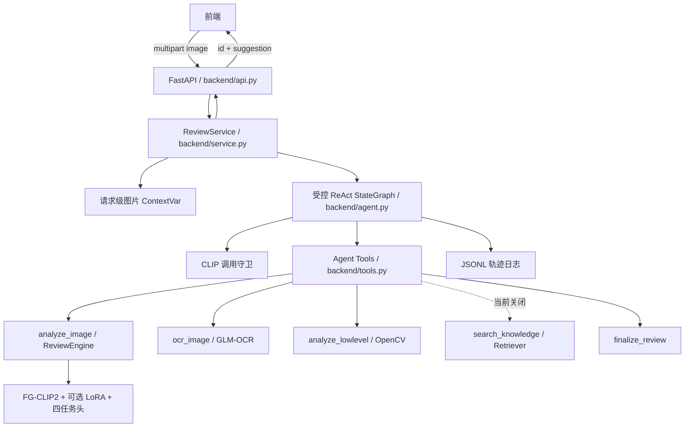

# 违规内容审核系统架构

> 当前架构：FG-CLIP2 必经工具 + 调用守卫 + ReAct 可选工具。本文以实际代码为准。

## 1. 系统边界

系统接收一张图片，返回审核编号和面向运营的建议文本。FG-CLIP2 是唯一视觉理解模块；LLM 不能直接查看图片，只能读取工具产生的文本证据。

所有视觉训练、推理和评估严格沿用当前 Label Studio 标注方式，不新增或替换标签任务。

## 2. 分层架构



## 3. Agent 行为

### 3.1 工具

| 工具                 |   必需性 | 职责                                               |
| -------------------- | -------: | -------------------------------------------------- |
| `analyze_image`    |     必须 | FG-CLIP2 输出四字段基础视觉证据                    |
| `ocr_image`        |     可选 | 调用智谱 GLM-OCR，提取广告、字幕、标语、水印等文字 |
| `analyze_lowlevel` |     可选 | 提供红色、模糊、边缘、细密纹理、信息熵提示         |
| `search_knowledge` | 当前关闭 | RAG 实现后用于检索规则或相似判例                   |
| `finalize_review`  | 最终动作 | 提交一句审核建议                                   |

### 3.2 调用守卫

调用守卫是程序约束，不依赖 Prompt 自觉：

```text
Agent 请求 finalize_review
    ├── clip_succeeded = true  → 接受建议并结束
    └── clip_succeeded = false → 拒绝提交并返回 Agent
```

如果 `analyze_image` 执行失败，状态记录 `clip_called=true`、`clip_succeeded=false`，流程返回“视觉模型不可用”，不得伪造正常审核结论。

同一请求重复调用 `analyze_image` 时读取请求缓存，不重复执行模型推理。

### 3.3 无显式 finalize 的兼容处理

若 LLM 已取得 CLIP 证据但直接返回非空文本，状态图可将该文本作为建议结束；若尚无 CLIP 证据，则守卫追加指令并要求调用 `analyze_image`。达到最大轮次时，只能生成明确标记的降级建议。

### 3.4 状态

`ReviewState` 的关键字段：

```text
messages            ReAct 消息流
filename            日志文件名
tool_results         结构化工具结果
steps                工具轨迹
rounds               LLM 轮次
clip_called          是否尝试调用 CLIP
clip_succeeded       CLIP 是否成功
suggestion           最终建议
finalized            是否结束
degraded             是否降级
```

图片二进制不在 State 中传播，而是存放在请求级 ContextVar。工具结果返回给 LLM 时转换为文本，完整结构只进入内部状态和日志。

## 4. 一次请求的时序

```text
1. API 限制大小并验证 jpg/png/webp 可解码
2. Service 创建 request_id 和图片 ContextVar
3. Agent 开始 ReAct
4. Agent 调用 analyze_image
5. ReviewEngine 读取图片并返回四任务结果
6. Agent 根据证据选择 GLM-OCR 或低层分析；本轮不注册 RAG
7. Agent 调用 finalize_review
8. 调用守卫检查 clip_succeeded
9. Service 写入工具轨迹和结构化证据
10. API 返回 id + suggestion
11. finally 中清理 ContextVar
```

## 5. 视觉模型

```text
图片
  ↓ AutoImageProcessor / 动态 max_num_patches
FG-CLIP2 Vision Transformer
  ↓ 768 维 pooler output
共享层 Linear(768,512) + GELU + Dropout
  ├── risk head: 5
  ├── violence type head: 4
  ├── injury head: 4
  └── quality head: 5
```

训练时冻结文本塔，对视觉塔的 `q_proj/k_proj/v_proj/out_proj` 注入 LoRA，并训练四任务头。

### 推理解码

- risk、injury、quality：softmax + argmax；
- violence type：sigmoid + 各类别阈值；
- 输出标签来自 `src/labels.py`；
- `trained=false` 表示分类头未加载训练权重，结果不能作为正式审核。

## 6. 标签与损失

| 字段          | 学习方式 | 缺失处理                |
| ------------- | -------- | ----------------------- |
| risk          | 加权 CE  | `IGNORE_INDEX`        |
| violence type | 加权 BCE | `type_valid` 样本掩码 |
| injury        | 加权 CE  | `IGNORE_INDEX`        |
| quality       | 加权 CE  | `IGNORE_INDEX`        |

总损失：

```text
1.0 × risk + 0.5 × type + 0.5 × injury + 0.5 × quality
```

缺失的 violence type 不会被编码成全负监督；没有有效样本时使用 `logits.sum() * 0` 保持计算图。

## 7. 数据规则

输入是 Label Studio JSON。当前数据仍在标注中，所以现有分布仅用于开发。

- “无暴力 + 其他暴力类型”属于确定性冲突，可清理；
- L0 + 直接暴力、L3 + 无暴力属于复核候选，不自动删除；
- 未标注任务不进入训练；
- 部分字段缺失时只忽略对应任务损失；
- 最终数据到位后重新体检并生成固定 `data/split.json`。

## 8. Checkpoint

最小 checkpoint：

```text
checkpoint/
├── adapter_config.json
├── adapter_model.safetensors
├── head.pt
├── labels.json
└── metrics.json
```

基础模型权重不重复保存。推理时组合：FG-CLIP2 基础权重 + LoRA adapter + 分类头。`labels.json` 用于防止标签顺序不一致。

## 9. Mock 与 real 模式

### Mock

用于无 GPU、无训练权重或无外部 API 时验证：

- 调用守卫；
- Agent 工具链；
- API；
- 日志；
- 前端联调。

Mock 结果必须标记，不用于正式指标。

### Real

真实模式加载 FG-CLIP2 与 DeepSeek 裁决模型。当前联调配置为 `lora=false`、`require_checkpoint=false`，因此使用原始视觉权重和随机初始化任务头，输出携带 `trained=false`，只能验证流程。训练完成后应恢复 LoRA 并强制 checkpoint。

## 10. GLM-OCR 工具架构

OCR Provider 已冻结为智谱 `glm-ocr`，模型、地址和密钥单独存放在
`config/ocr.yaml`，后端总配置只引用该文件。密钥默认留空，运行时可通过
`OCR_API_KEY` 环境变量覆盖。

```text
Agent 调用 ocr_image
  ↓
OCRClient 读取请求级图片 bytes
  ↓
校验并将非 JPG/PNG 图片转成 PNG
  ↓
Base64 data URI 编码（携带 image/jpeg 或 image/png MIME）
  ↓
POST /api/paas/v4/layout_parsing
  ↓
解析 layout_details / md_results
  ↓
返回 success + texts + normalized boxes
  ↓
工具只把文字证据交给 Agent
```

统一内部结果：

```json
{
  "success": true,
  "available": true,
  "provider": "glm_ocr",
  "model": "GLM-OCR",
  "texts": ["识别出的文字"],
  "boxes": [[0.1, 0.2, 0.8, 0.4]],
  "box_format": "normalized_xyxy",
  "request_id": "req-...",
  "error": null
}
```

必须区分三种状态：成功且有文字、成功但无文字、调用失败。GLM-OCR 只负责字符
和版面提取，不允许其承担违规内容语义判断，FG-CLIP2 仍是唯一通用视觉语义模型。

## 11. DeepSeek 裁决模型

裁决 LLM 固定为 `deepseek-v4-flash`，模型名、OpenAI 兼容地址、超时和密钥独立存放在 `config/llm.yaml`。运行时 `LLM_API_KEY` 优先于文件值。LLM 只接收工具文字证据，不接收原始图片。

```text
ReviewState + System Prompt
  ↓ bind_tools
DeepSeek-V4-Flash / OpenAI Chat Completions 兼容接口
  ↓ tool_calls
受控 StateGraph + CLIP 调用守卫
```

当前 `features.rag_enabled=false` 同时作用于工具注册和系统提示词，确保 Agent 无法实际调用尚未实现的 RAG。后续 RAG 推荐使用“FG-CLIP 图像向量 + 四任务结构化摘要 + 可选 OCR 文字”的混合检索，不要求 FG-CLIP 生成其不具备的自然语言图像描述。

## 12. 故障行为

| 故障              | 行为                                                     |
| ----------------- | -------------------------------------------------------- |
| 图片无效          | API 返回 40001                                           |
| 缺少 image        | API 返回 40002                                           |
| 服务未初始化      | API 返回 50300                                           |
| CLIP 失败         | 结束并说明无法完成视觉审核                               |
| GLM-OCR 未配置    | 明确告知 Agent 本次没有 OCR 证据                         |
| GLM-OCR 调用失败  | 记录 timeout/http 状态，按配置跳过或终止                 |
| 低层工具失败      | 按配置跳过或终止                                         |
| RAG 关闭          | 工具不注册，提示词明确禁止调用                           |
| DeepSeek Key 缺失 | 启动时明确提示配置`config/llm.yaml` 或 `LLM_API_KEY` |
| LLM/Agent 异常    | 返回明确的流程不可用建议并记录日志                       |

## 13. 当前实现状态

已实现：

- Label Studio 解析和缺失标签表示；
- 确定性冲突清理与复核候选；
- FG-CLIP2 processor 和真实视觉前向；
- LoRA 视觉塔与四任务头；
- 加权多任务损失和 type 掩码；
- checkpoint 保存/加载接口；
- 调用守卫和工具缓存；
- Mock 端到端流程；
- GLM-OCR JSON+Base64 请求与版面结果适配；
- DeepSeek-V4-Flash 独立配置与 LangChain 适配；
- RAG 工具硬关闭开关；
- Python 3.12 + CUDA 12.8 项目虚拟环境与真实基模前向验证；
- DeepSeek-V4-Flash 真实 Agent 全链路验证；
- GLM-OCR Base64 data URI 真实接口验证；
- API 基础校验和统一错误结构；
- 最小训练、评估入口；
- 自动化测试。

当前真实联调结果：

- `/health` 返回 `mock=false`、模型已加载；
- 示例链路成功执行 `analyze_image → analyze_lowlevel → finalize_review`；
- CLIP 调用守卫通过，Agent 正常收敛且未降级；
- OCR 独立真实调用成功；
- 自动化测试 15 项通过。

仍依赖外部条件：

- 最终标注 JSON 与完整图片目录；
- 正式训练 checkpoint；
- RAG 判例库。

## 14. 仓库与敏感信息边界

GitHub 仓库只保存代码、测试、文档和无密钥配置模板。整个 `fg_clip/`、checkpoint、数据、测试图片、评估产物、阶段性标注 JSON、真实 LLM/OCR 配置、本地环境和日志均由 `.gitignore` 排除。模型与数据通过外部存储协作，不能直接写入 Git 历史。
