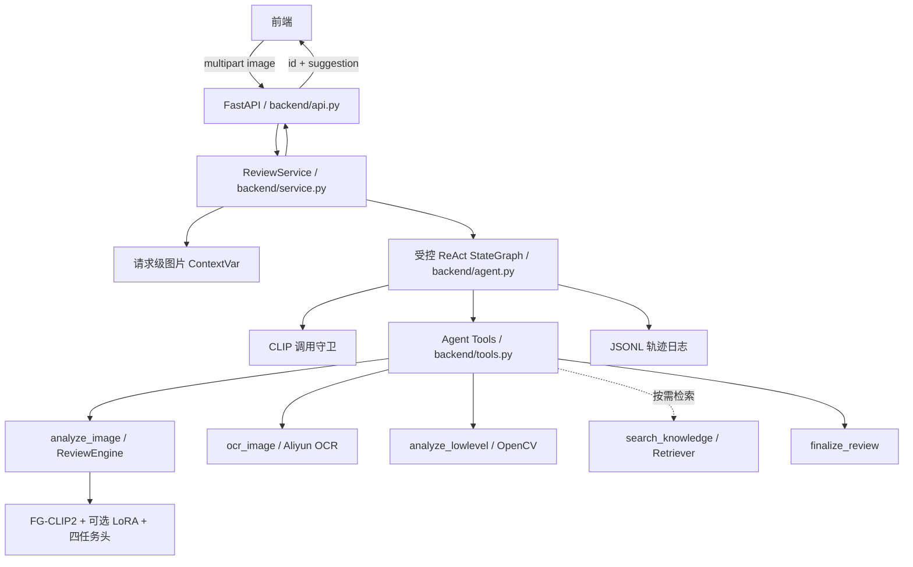

# 违规内容审核系统架构

> 当前架构：FG-CLIP2 必经工具 + 调用守卫 + ReAct 可选工具。本文以实际代码为准。

## 1. 系统边界

系统接收一张图片，返回审核编号和面向运营的建议文本。FG-CLIP2 是唯一视觉理解模块；LLM 不能直接查看图片，只能读取工具产生的文本证据。

所有视觉训练、推理和评估严格沿用当前 Label Studio 标注方式，不新增或替换标签任务。

## 2. 分层架构



## 3. Agent 行为

### 3.1 工具

| 工具                 |   必需性 | 职责                                               |
| -------------------- | -------: | -------------------------------------------------- |
| `analyze_image`    |     必须 | FG-CLIP2 输出四字段基础视觉证据                    |
| `ocr_image`        |     可选 | 调用 OCR Provider，提取广告、字幕、标语、水印等文字和置信度 |
| `analyze_lowlevel` |     可选 | 提供红色、模糊、边缘、细密纹理、信息熵提示         |
| `search_knowledge` | 按需调用 | CLIP 成功后检索本地规则与案例，结果仅作辅助证据     |
| `match_scene_concepts` | 按需调用 | 仅在风险非 L0 时返回开放词汇场景候选和 RAG 规则 |
| `finalize_review`  | 最终动作 | 提交一句审核建议                                   |

### 3.2 调用守卫

调用守卫是程序约束，不依赖 Prompt 自觉：

```text
Agent 请求 finalize_review
    ├── clip_succeeded = true  → 接受建议并结束
    └── clip_succeeded = false → 拒绝提交并返回 Agent
```

如果 `analyze_image` 执行失败，状态记录 `clip_called=true`、`clip_succeeded=false`，流程返回“视觉模型不可用”，不得伪造正常审核结论。

同一请求重复调用 `analyze_image` 时读取请求缓存，不重复执行模型推理。

### 3.3 无显式 finalize 的兼容处理

若 LLM 已取得 CLIP 证据但直接返回非空文本，状态图可将该文本作为建议结束；若尚无 CLIP 证据，则守卫追加指令并要求调用 `analyze_image`。达到最大轮次时，只能生成明确标记的降级建议。

### 3.4 状态

`ReviewState` 的关键字段：

```text
messages            ReAct 消息流
filename            日志文件名
tool_results         结构化工具结果
steps                工具轨迹
rounds               LLM 轮次
clip_called          是否尝试调用 CLIP
clip_succeeded       CLIP 是否成功
suggestion           最终建议
finalized            是否结束
degraded             是否降级
```

图片二进制不在 State 中传播，而是存放在请求级 ContextVar。工具结果返回给 LLM 时转换为文本，完整结构只进入内部状态和日志。

### 3.5 L0 快速结束

`analyze_image` 返回后，只有高置信度 L0 才快速结束：

- risk confidence >= 0.75
- 没有暴力类型、血腥或 binary injury 冲突
- quality 没有严重模糊、文字扭曲或故意遮挡
- 低层文字密度没有触发 OCR 候选

- Agent 图立即结束，不再请求 LLM 的下一轮工具调用。
- OCR、低层分析、场景概念和 RAG 即使被误调用，也会在工具内部返回 skipped。
- 最终动作仍由程序策略生成，LLM 不再追加可选证据。

非 L0 时，程序在 `analyze_image` 内自动执行一次场景概念匹配；
quality 命中文字扭曲、低层特征疑似文字或 L0 因低置信度/文字风险未短路时自动执行 OCR。

### 3.6 统一证据包

每次审核记录 `decision_evidence`，统一包含：

- risk / type / injury / quality 四个主头输出
- binary injury
- 低层图像质量特征及其文字探测状态
- OCR 状态和规则命中
- 场景概念结果
- Agent 自己调用的 `search_knowledge` 命中（按规则 id 去重）

该结构不包含 OCR 原文或知识正文，只保存结构化分数、规则 id 和状态。

### 3.7 LLM 最终解释

程序调用 `decide()` 完成 `allow / limit / review / block` 后，才会启动独立解释生成器：

- 输入同时包含完整 `decision_evidence` 和只读的 `program_decision`；
- 解释模型不再绑定工具，不能继续获取图片或改写证据；
- LLM 只输出 JSON 中的解释正文，不得输出任何处置动作词；
- 程序拼接权威的“审核结果”和“处置”标题，再附加 LLM 解释与程序依据；
- 模型调用失败、返回工具调用、JSON 无效、解释含其他处置动作或长度异常时，自动退回确定性 `render(decision)`；
- 日志通过 `final_explanation.status` 和 `suggestion_source` 区分 `llm_explanation` 与 `deterministic_fallback`。

因此 LLM 对最终可读性负责，对处置动作不拥有决定权。

### 3.8 处置口径

- 高置信、无冲突的安全结果可以放行；
- 风险等级为 `X_无法判定`、分类分数缺失、风险与内容头冲突、证据不足或
  二元血腥头与四分类血腥候选冲突时，统一进入人工复核；
- 单纯 L0 的 softmax 分数不高、但其他头和 binary/quality 证据无冲突时不强制复核；
  `0.75` 只用于 L0 是否跳过可选工具的条件短路，不直接代替最终处置；
- 风险头支持轻中度违规，并有类型、血腥、OCR 高风险规则等独立证据时采用限流；
- 风险头支持严重违规，并由严重血腥或攻击进行中提供支持时下架；
- quality 的严重模糊、文字扭曲和遮挡作为可靠性警告，不单独降低或升级动作；
- 新闻、医学等安全语境必须有场景 Prompt 与 OCR/RAG 第二证据共同确认，
  且视觉存在违规时最多降为限流，不能直接放行。

策略版本为 `2026-10-23-v4`。此前“不确定放行”的口径已废止。

## 4. 一次请求的时序

```text
1. API 限制大小并验证 jpg/png/webp 可解码
2. Service 创建 request_id 和图片 ContextVar
3. Agent 开始 ReAct
4. Agent 调用 analyze_image
5. ReviewEngine 读取图片并返回四任务结果
6. Agent 根据证据选择 OCR、低层分析或本地 RAG 检索
7. Agent 调用 finalize_review
8. 调用守卫检查 clip_succeeded
9. Service 汇总 decision_evidence 并由程序生成最终 decision
10. LLM 基于完整证据只生成解释，程序校验失败时确定性回退
11. Service 写入工具轨迹、结构化证据和解释状态
12. API 返回 id + suggestion
13. finally 中清理 ContextVar
```

## 5. 视觉模型

```text
图片
  ↓ AutoImageProcessor / 动态 max_num_patches
FG-CLIP2 Vision Transformer
  ↓ 768 维 pooler output
共享层 Linear(768,512) + GELU + Dropout
  ├── risk head: 5
  ├── violence type head: 4
  ├── injury head: 4
  └── quality head: 5

同一 768 维视觉 embedding 还输入一个独立的 binary injury head：
  └── blood/no-blood: 1（验证集校准阈值，默认 FPR 预算 10%）

quality 任务使用独立融合头：
  FG-CLIP2 embedding(768) + 低层质量特征(15) → MLP → 5 个多标签输出
```

训练时冻结文本塔，对视觉塔的 `q_proj/k_proj/v_proj/out_proj` 注入 LoRA，并训练四任务头。

### 推理解码

- risk、injury：softmax + argmax（单标签）；
- blood_binary：sigmoid + 验证集校准阈值，只判断是否存在血腥，不覆盖四类 severity；
- quality：融合头逐类阈值，严重模糊/文字扭曲/故意遮挡作为证据可靠性提示，不单独决定复核；
- violence type、quality：逐类 sigmoid + 各自阈值（多标签，可同时命中多个；没有类别过阈值时返回空列表，不强制选一个）；
- 输出标签来自 `src/labels.py`；
- 多标签阈值来自 `config/inference.yaml`（`src/cli.py` 读取），也可由 `ReviewEngine` 参数覆盖；
- `trained=false` 表示分类头未加载训练权重，结果不能作为正式审核。

## 6. 标签与损失

| 字段          | 学习方式 | 缺失处理                |
| ------------- | -------- | ----------------------- |
| risk          | 加权 CE  | `IGNORE_INDEX`        |
| violence type | 加权 BCE | `type_valid` 样本掩码 |
| injury        | 加权 CE  | `IGNORE_INDEX`        |
| quality       | 加权 BCE | `quality_valid` 掩码  |

总损失：

```text
1.0 × risk + 0.5 × type + 0.5 × injury + 0.5 × quality
```

缺失的 violence type / quality 不会被编码成全负监督；没有有效样本时使用 `logits.sum() * 0` 保持计算图。quality 无法完整映射时按缺失处理（`quality_valid=False`），该样本不参与 quality 训练与评估。

## 7. 数据规则

输入是 Label Studio JSON；`python -m src.build_dataset` 负责配对、标签头收敛与确定性清洗，输出可直接训练的 `data/clean/`。

- 图片与标签按 `file_upload` 文件名一一配对，缺图任务剔除；无标签的图片不进数据集；
- 训练标签文件只保留 `risk_level` / `violence_type` / `injury_detail` / `quality` 四个模型输出头，`target` / `note` 剥离到 `review_extras.json`；
- 确定性矛盾按主因删除：`无暴力 + 其他暴力类型`、`L0_安全` 却标直接暴力/后果展示、`L0_安全` 却有血腥、`L0_安全` 却标暗示/威胁、`L1/L2/L3` 却无暴力且无血腥、`L1/L2/L3` 却缺失表现字段；
- `L0_安全` 却严重模糊/文字扭曲、`X` 却标「清晰」只进入复核清单，不自动改标签；
- 未标注任务不进入训练；部分字段缺失时只忽略对应任务损失；
- 最终数据到位后重新体检并生成固定 `data/split.json`（冒烟划分在 `data/smoke/split.json`）。

## 8. Checkpoint

最小 checkpoint：

```text
checkpoint/
├── adapter_config.json
├── adapter_model.safetensors
├── head.pt
├── labels.json
└── metrics.json
```

基础模型权重不重复保存。推理时组合：FG-CLIP2 基础权重 + LoRA adapter + 分类头。`labels.json` 用于防止标签顺序不一致。

`labels.json` 由 `labels.checkpoint_schema()` 生成，含 `schema_version: 2` 与 `task_types`（quality 为 `multi_label`）。加载时缺 `labels.json` 或 schema 不匹配都会直接报错，避免把旧单标签 quality 权重当成多标签头使用。

## 9. Mock 与 real 模式

### Mock

用于无 GPU、无训练权重或无外部 API 时验证：

- 调用守卫；
- Agent 工具链；
- API；
- 日志；
- 前端联调。

Mock 结果必须标记，不用于正式指标。

### Real

真实模式加载 FG-CLIP2 与 DeepSeek，当前配置为 `lora=true`、`require_checkpoint=true`，必须加载训练后的 LoRA 和四任务分类头。Mock 模式用于流程演示，其输出不代表真实模型效果。

## 10. OCR 工具架构

当前默认 Provider 为阿里云高精版 OCR：

- Endpoint：`https://gjbsb.market.alicloudapi.com/ocrservice/advanced`
- 鉴权：`Authorization: APPCODE <AppCode>`
- 请求体：纯 Base64 字段 `img`，支持 `prob` 行置信度

旧 GLM-OCR Provider 仍兼容。本地配置位于 `config/ocr.yaml`，被 Git 忽略；
阿里云 AppCode 可用 `ALIYUN_OCR_APPCODE` 环境变量覆盖。

```text
Agent 调用 ocr_image
  ↓
OCRClient 读取请求级图片 bytes
  ↓
校验并将非 JPG/PNG 图片转成 PNG
  ↓
Base64 编码
  ↓
POST 阿里云 `/ocrservice/advanced`
  ↓
解析 prism_rowsInfo / prism_wordsInfo / prob
  ↓
返回 success + texts + normalized boxes
  ↓
工具只把文字证据交给 Agent
```

统一内部结果：

```json
{
  "success": true,
  "available": true,
  "provider": "aliyun_market_ocr",
  "model": "advanced",
  "texts": ["识别出的文字"],
  "boxes": [[0.1, 0.2, 0.8, 0.4]],
  "mean_confidence": 0.88,
  "line_confidences": [0.88],
  "box_format": "normalized_xyxy",
  "request_id": "req-...",
  "error": null
}
```

必须区分三种状态：成功且有文字、成功但无文字、调用失败。OCR 只负责字符
和版面提取，不允许其承担违规内容语义判断，FG-CLIP2 仍是唯一通用视觉语义模型。

## 11. DeepSeek 裁决模型

裁决 LLM 固定为 `deepseek-v4-flash`，模型名、OpenAI 兼容地址、超时和密钥独立存放在 `config/llm.yaml`。运行时 `LLM_API_KEY` 优先于文件值。LLM 只接收工具文字证据，不接收原始图片。

```text
ReviewState + System Prompt
  ↓ bind_tools
DeepSeek-V4-Flash / OpenAI Chat Completions 兼容接口
  ↓ tool_calls
受控 StateGraph + CLIP 调用守卫
```

当前 `features.rag_enabled=true`，启用标准库字符 n-gram TF-IDF 检索；关闭时同时移除工具并调整提示词。Agent 根据视觉标签及可选 OCR 文字构造文本查询，不进行图片向量检索。规则库、校准集及使用边界见 [RAG 与前端实现说明](RAG与前端实现说明.md)。最终处置继续遵循现有程序规则。

## 12. 故障行为

| 故障              | 行为                                                     |
| ----------------- | -------------------------------------------------------- |
| 图片无效          | API 返回 40001                                           |
| 缺少 image        | API 返回 40002                                           |
| 服务未初始化      | API 返回 50300                                           |
| CLIP 失败         | 结束并说明无法完成视觉审核                               |
| OCR 未配置        | 明确告知 Agent 本次没有 OCR 证据                         |
| OCR 调用失败      | 记录 timeout/http 状态，按配置跳过或终止                 |
| 低层工具失败      | 按配置跳过或终止                                         |
| RAG 关闭          | 工具不注册，提示词明确禁止调用                           |
| DeepSeek Key 缺失 | 启动时明确提示配置`config/llm.yaml` 或 `LLM_API_KEY` |
| LLM/Agent 异常    | 返回明确的流程不可用建议并记录日志                       |

## 13. 当前实现状态

已实现：

- Label Studio 解析和缺失标签表示；
- 确定性冲突清理与复核候选；
- FG-CLIP2 processor 和真实视觉前向；
- LoRA 视觉塔与四任务头；
- 加权多任务损失与 type/quality 多标签掩码；
- 数据配对、标签头收敛与确定性清洗（`src/build_dataset.py`，输出 `data/clean/`）；
- 推理配置 `config/inference.yaml` 实际生效（`src/cli.py` 读取 type/quality 阈值）；
- checkpoint 保存/加载接口；
- 调用守卫和工具缓存；
- Mock 端到端流程；
- 阿里云 AppCode OCR 请求、行文字、坐标和置信度解析；
- DeepSeek-V4-Flash 独立配置与 LangChain 适配；
- 本地 RAG 规则与案例检索，以及工具启停开关；
- Python 3.12 + CUDA 12.8 项目虚拟环境与真实基模前向验证；
- DeepSeek-V4-Flash 真实 Agent 全链路验证；
- 阿里云高精版 OCR 真实接口验证；
- binary injury、quality fusion、场景概念和 LLM 最终解释已接入；
- solid、quality 与 OCR 小样本报告已生成；
- API 基础校验和统一错误结构；
- 最小训练、评估入口；
- 自动化测试 138 项。

当前真实联调结果：

- `/health` 返回 `mock=false`、模型已加载；
- 示例链路成功执行 `analyze_image → 自动 OCR / 场景概念 → finalize_review → LLM 解释`；
- CLIP 调用守卫通过，Agent 正常收敛且未降级；
- 阿里云 OCR 与 DeepSeek 解释器真实调用成功；
- 自动化测试 138 项通过。

仍依赖外部条件：

- 真实后端进程级端到端验证与请求耗时统计；
- 请求级总超时和正式部署限流；
- RAG 独立评测查询与知识库持续维护。

## 14. 仓库与敏感信息边界

GitHub 仓库只保存代码、测试、文档、无密钥配置模板和明确放行的小型部署 checkpoint。
基础模型、实验图片、数据、评估产物、阶段性标注 JSON、真实 LLM/OCR 配置、
本地环境和日志均由 `.gitignore` 排除。任何曾暴露的真实密钥都应轮换。
