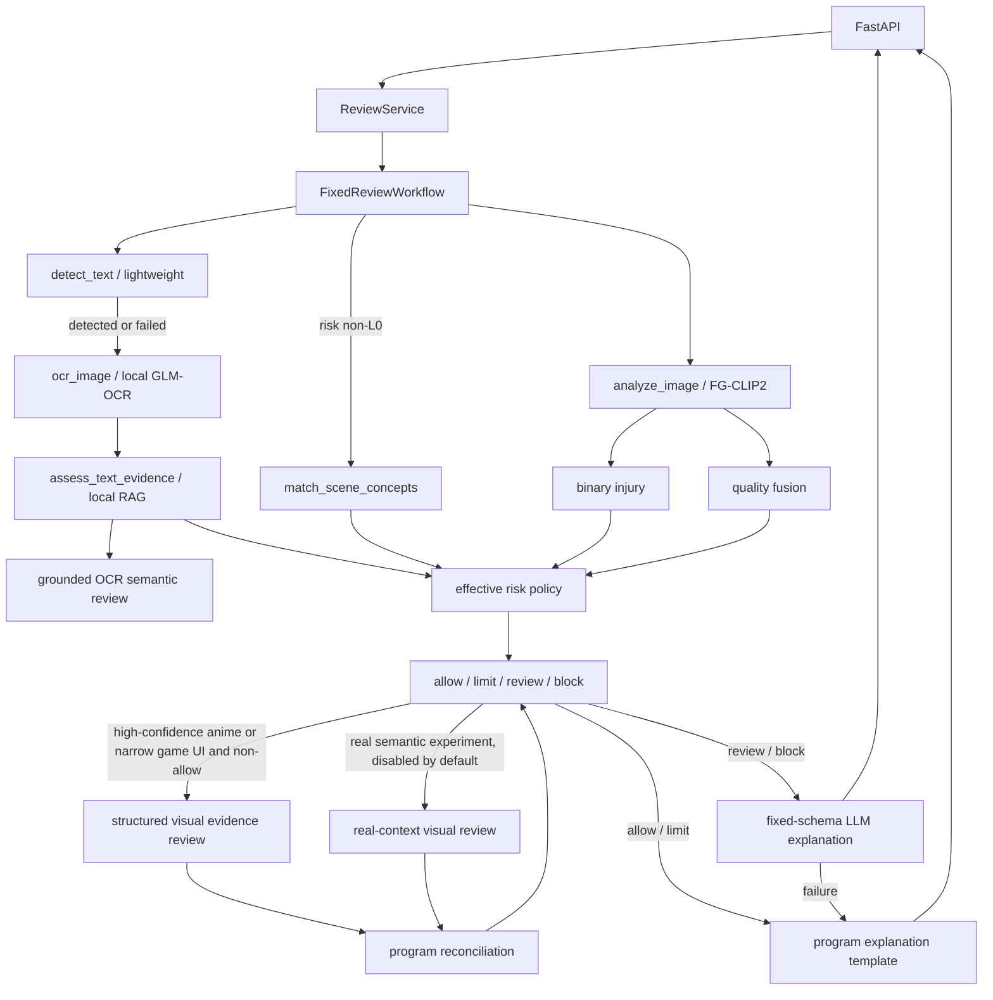

# 违规内容审核系统架构

> 当前架构：FG-CLIP2 证据 + 固定条件式工具流程 + effective risk policy v2 + 受限语义视觉 LLM。

## 1. 系统边界

系统接收一张图片，返回审核编号和面向运营的建议。FG-CLIP2 提供通用视觉证据；OCR、RAG 和场景 Prompt 补充语境；动漫/游戏 UI 窄路由可调用结构化视觉 LLM；程序始终锁定最终动作。

## 2. 固定流程



不存在 ReAct 循环、LLM 工具选择、`finalize_review` 或 LangGraph 调用守卫。

## 3. 工具

| 工具 | 触发条件 | 职责 |
|---|---|---|
| `analyze_image` | 每张图 | risk、type、injury、quality fusion、binary |
| `detect_text` | 每张图 | 判断是否存在文字候选区域 |
| `ocr_image` | 文字检测命中或检测失败 | 调用本地 GLM-OCR 整图识别，不做判罚 |
| `assess_text_evidence` | OCR 成功后 | 文本质量和本地 RAG 规则命中 |
| `text_semantic_review` | OCR 有非空文本 | 逐字 quote 校验和文字违规语义 |
| `match_scene_concepts` | risk 非 L0，并行 OCR | 风险场景、安全语境、混淆项、域候选、游戏 UI 路由候选 |

请求级图片和缓存存放在 `ContextVar`，不进入 LLM 或前端状态。

`review_blood` 是早期实验遗留代码，不属于当前固定流程。`run_backend.py`
不会创建该客户端，因此生产服务不会注册、调用或展示这一工具；前端也只展示实际执行过的复核。

## 4. 文字检测

默认实现为 `LightweightTextDetector`：

- OpenCV Sobel/形态学生成文字行候选；
- 对候选区域检查等高字符组件、基线一致性和横向间隔；
- 只返回状态、区域数、框和置信度，不读取文字。

检测策略是高召回：

- `detected`：执行 OCR；
- `failed`：执行 OCR并标记降级；
- `empty`：跳过 OCR；
- 高置信 L0 也必须先执行文本检测。

`quality=文字扭曲形变` 不再单独调用 OCR。它只在真实域文字检测命中但 OCR 无法读取时作为可靠性保护。

可选 `RapidOCRTextDetector` 在本地 RapidOCR 可用时启用：

```yaml
text_detection:
  provider: "rapidocr"
```

OCR 文本语义复核只输出 `violation/safe/uncertain`。`violation` 必须包含 OCR
原文中逐字出现且至少 3 字符的 `quote`，同时说明对象和伤害动作；`quote`
内容不匹配时判为无效，不允许模型补造。另保留一个窄规则，只处理
“条件/邀请行为 + 第一人称伤害响应”，同时排除新闻、引用、否定和虚构表达。

生产 OCR 使用独立 `glmocr` conda 环境中的 GLM-OCR 0.9B。vLLM 在 GPU
提供 OpenAI 兼容接口，PP-DocLayoutV3 文档布局模型在 CPU 上作为可选文档模式；
普通图片审核绕过布局流水线，直接进行一次整图 `Text Recognition:` 请求。
OCR 与场景 Prompt 在 CLIP 完成后并行执行。

## 5. 模型输出

```text
FG-CLIP2 视觉 embedding
  ├── risk head: L0/L1/L2/L3/X
  ├── type head: 4 个独立二分类
  ├── injury head: 4 类严重程度
  ├── quality fusion: 5 个独立标签
  └── binary injury: 血腥存在性
```

risk、type、injury 和 quality 是独立估计器，相互没有因果边。训练时通过共享表征和联合损失产生统计相关。

quality fusion 加载后覆盖旧 quality 输出，策略只使用 fusion 结果。

## 6. effective risk

程序保留：

```text
risk_raw        risk 头原始 argmax 和全部分数
effective_risk  综合内容和语境证据后的策略等级
```

binary 采用三段式：

```text
p >= threshold                         positive
threshold-clear_margin < p < threshold uncertain
p <= threshold-clear_margin            clear_negative
```

策略原则：

- binary 阴性只否决血腥支持，不删除独立攻击、威胁或文字证据；
- risk L1/L2 + binary clear negative + 无独立内容支持，才可能进入假冲突降级；
- 动漫/插画域 Prompt、动漫域质量异常、已确认安全语境和场景混淆项可解释假冲突；
- 真实图片语义自动放行默认关闭；
- `risk_without_support` 无法解除时采用保守限流；
- `risk_X` 只有在类型头、binary、质量、场景 Prompt 和 OCR/RAG 全部一致阴性时放行；
- L3 只有在 OCR 安全食物/酱汁语义、红色液体 Prompt、binary 阴性和无独立暴力同时成立时走窄放行；
- 分数缺失、行为冲突、binary 近阈值和 OCR 未完成仍保留复核；
- 安全语境最多把下架降为限流；
- RAG 高风险命中本身不直接限流；必须由逐字 quote 或窄条件规则确认。
  若语义复核无法给出 safe 或 grounded violation，则进入人工核对。
- 确认高风险 OCR 文字可独立把 L0 提升为限流。

详细口径和冻结探针见 [EFFECTIVE_POLICY_V5_2026-10-26.md](EFFECTIVE_POLICY_V5_2026-10-26.md)。

## 7. 语义视觉复核

动漫分流使用冻结 CLIP embedding 的轻量 style router；低置信默认走真实策略。
另外允许一个不给最终动作投票的游戏 UI 路由候选：类型头命中武器，且冻结
FG-CLIP2 的 `game_ui_weapon_display` Prompt 分数达到 `0.039`。该候选用于解决
3D 游戏界面被 style router 判为 real、无法进入复核的问题。

动漫/游戏 UI 视觉 LLM 只在以下条件同时满足时触发：

- style score >= 配置门槛；动漫路由未命中时，游戏 UI 武器候选可作为兜底；
- 初步动作不是 allow；
- 没有 grounded OCR 文字违规；
- 高风险 RAG 文本没有明确 safe 结论。

两类路由同时命中时保留动漫路由来源，避免改变既有动漫样本的复核依据。

真实图片语义实验代码支持新闻执法、军警执勤和合法武器展示，但默认
`real_context_enabled=false`。医学和体育不触发真实图片视觉路由。即使显式启用，
还要求 binary 明确阴性、直接暴力类型分数低于 0.65，视觉返回 `real_photo` 且
injury/attack/threat 全部 absent。

视觉结构包括 injury、attack、threat、weapon_visible、context、appearance、
threat_basis、threat_target、weapon_pose 和 reason。程序负责最终动作：

- 明确游戏/虚构语境且 injury/attack/threat 全部 absent：可允许；
- `threat=uncertain` 不允许直接撤回；
- 暗黑风格、injury mild 或任一关系不确定：L1 限流，不转人工；
- 原风险 L3 或仅持械不再单独决定 L1；
- 明确伤害、攻击或威胁：保留原动作；
- 游戏 UI 候选触发后，视觉返回 real_photo、illustration 或 unknown：保留原动作；
- grounded 文字违规或视觉调用失败：不撤回原限制。

详细说明见 [ANIME_VISION_STRATEGY_2026-10-27.md](ANIME_VISION_STRATEGY_2026-10-27.md)。

### 7.1 解释策略

解释层以程序模板为主。`allow`、`limit` 不调用解释 LLM；`review`、`block`
才调用 LLM，并且 LLM 只能填写 `summary`、`evidence_note`、`limitation`
三个固定字段。动作、有效风险、复核建议和程序理由始终由程序生成。

`review` 会额外输出 `recommended_action`、`review_reason`。例如建议限流或建议下架，
用于指导人工操作，但不改变 `action=review`。

## 8. 场景 Prompt

场景概念来自冻结 FG-CLIP2 图文相似度：

- `risk`：武器威胁、直接攻击、血腥、暴力文字、动物虐待；
- `safe_context`：医学、新闻、军警执勤、虚构、反暴力；
- `confounder`：红色颜料/物体、合法武器展示；
- `routing_signal`：游戏 UI/武器皮肤候选，只控制视觉复核路由，不参与动作投票；
- `domain`：二次元插画、真实照片。

域 Prompt 当前仅作为策略证据，不是独立风格分类指标。默认门槛基于已有探针临时确定，需用独立二次元数据重新校准。

## 9. 日志与审计

日志保留：

- 输入图片哈希、请求编号、模型和 checkpoint 身份；
- 工具步骤、耗时、错误类型；
- 后端总耗时及模型、文字、复核、解释、策略阶段的毫秒耗时；
- CLIP/binary/quality 全部分数和阈值；
- 文字检测状态、区域数和置信度；
- OCR 状态、字符数、文本 SHA-256、平均置信度和请求 ID；
- RAG 规则 ID；
- `risk_raw`、`effective_risk`、冲突类型和调整原因；
- 最终解释状态。

日志不保存 OCR 原文、RAG 正文、消息历史或检索查询原文。

## 10. 故障处理

| 故障 | 行为 |
|---|---|
| CLIP 失败 | 不运行 OCR/场景，返回流程不可用 |
| 文字检测失败 | 执行 OCR并标记降级 |
| OCR 未执行且检测到文字 | 不能自动放行 |
| OCR 工具调用失败 | 记录失败状态；最终动作由其他证据决定 |
| RAG 不可用 | 文字证据缺失，不补造语义 |
| 场景 Prompt 失败 | 基础 CLIP 证据仍有效 |
| LLM 解释失败 | 使用确定性 `render()` |

## 11. 测试与评估

```bash
python -B -m unittest discover -s tests -v
```

冻结策略评估：

```bash
python -B -m src.evaluate_effective_policy ...
python -B -m src.evaluate_text_detection ...
```

当前自动化测试覆盖固定流程、文字检测门控、域证据、真实/动漫策略、日志脱敏、
结构化 API、工具状态分组、耗时埋点、前端结果工作台和解释权限。
